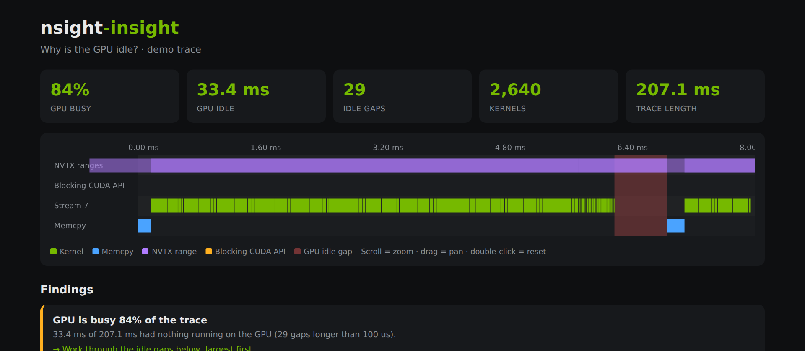

# nsight-insight

[](https://github.com/Hanan-AI-eng/nsight-insight/actions)

**Why is my GPU idle?** `nsight-insight` reads an [NVIDIA Nsight Systems](https://developer.nvidia.com/nsight-systems) trace and doesn't just show the timeline: it finds every stretch where the GPU sits idle and says *what the CPU was doing at that moment* (blocked in `cudaStreamSynchronize`, inside an NVTX range such as `dataloader.next`, ...), then suggests a fix.



[Open an example report](examples/demo-report.html) (download and open in a browser) · no GPU required to try it.

## Quick start

```bash
pip install .                  # no dependencies, Python 3.8+
nsight-insight --demo          # analyse a built-in synthetic trace -> report.html
```

On your own workload:

```bash
nsys profile --trace=cuda,nvtx -o run python train.py
nsight-insight run.nsys-rep -o report.html     # runs `nsys export --type sqlite` for you
# or, manually:
nsys export --type sqlite run.nsys-rep
nsight-insight run.sqlite -o report.html --json findings.json
```

Options: `--min-gap-us` (smallest idle gap to report, default 100), `--max-events` (timeline size cap), `--json` (machine-readable findings for CI/regression checks).

## What it tells you

| Check | How it works | Typical fix |
|---|---|---|
| **GPU utilisation** | Union of all kernel and memcpy intervals vs. trace length | Work the idle gaps below |
| **Idle-gap attribution** | For each gap, finds a blocking CUDA API call (`*Synchronize`, `cudaMemcpy`, `cudaMalloc`, ...) overlapping it, and the innermost NVTX range covering it | Overlap CPU work with GPU work, remove syncs |
| **Idle time per NVTX range** | Sums idle time under each range | Focus on the range that starves the GPU |
| **Copy/compute overlap** | Interval-overlap of memcpy against kernels | Async copies on a separate stream, pinned memory |
| **Launch-bound kernels** | Share of kernels shorter than 10 us | Kernel fusion, CUDA Graphs |
| **Single-stream serialisation** | Distinct streams used | Put independent work on separate streams |
| **Dominant kernel** | Kernel share of total kernel time | Deep-dive with Nsight Compute |

The HTML report is a single self-contained file: zoomable/pannable timeline with NVTX, blocking-API, kernel and memcpy lanes, idle gaps highlighted, and a "Show on timeline" button for each finding.

## How it works

```
nsight_insight/
  loader.py    reads the Nsight SQLite export; tolerant of missing tables and column differences
  analysis.py  interval algebra (merge, bisect-based overlap), gap attribution, findings
  report.py    renders a self-contained HTML report from template.html
  demo.py      generates a synthetic trace with realistic problems for demos and tests
  cli.py       command-line interface
tests/         pytest suite (interval maths, attribution, loader robustness, CLI)
```

Design notes:
- Pure standard library; analysis is O(n log n) in the number of events.
- Everything is derived from the documented tables of the `nsys` SQLite export (`CUPTI_ACTIVITY_KIND_KERNEL`, `_MEMCPY`, `_RUNTIME`, `NVTX_EVENTS`, `StringIds`). Schemas differ slightly across Nsight versions, so the loader falls back gracefully.
- Idle time is measured on the *union* of kernel and memcpy activity, so concurrent streams are not double-counted.

## Development

```bash
pip install -e ".[dev]"
pytest
```

## Limitations and roadmap

- Single-GPU focus; multi-GPU / NCCL analysis is not implemented yet.
- Gap causes are heuristic (blocking API and NVTX context) and point you to where to look; they are not proof.
- Planned: diff two traces (before/after an optimisation), Python-level sampling attribution, JSON threshold checks for CI.

## License

MIT
